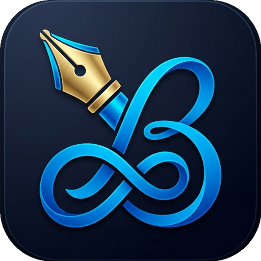

  

# BigNotes

A fast, smooth, vertical-scrolling digital notebook designed for Android tablets.

---

### Download

**[Download BigNotes v1.3 (APK)](https://github.com/anshumangaurav13/app.goodboy13.bignotes/releases/download/v1.3/app-release.apk)**

---

## Why BigNotes?

BigNotes gives you the focus of a real physical notebook with the flexibility of digital notes. Whether you're taking lecture notes, sketching ideas, or working through math problems, writing feels natural, fast, and grounded.

### Highlights

- **Real Ink on Paper:** Writes like a genuine fountain pen. Ink bleeds subtly into paper fibers and naturally darkens when you write over existing strokes.
- **Textured Pencil:** Feels like real graphite gliding over textured paper tooth.
- **Zero Lag:** Designed from the ground up for styluses (S Pen, Lenovo Pen, USI) for an instant, paper-like writing feel.
- **Continuous Vertical Notebook:** Write uninterrupted with smooth vertical scrolling, gentle zoom, and locked rotation—no spinning or disorienting drift, just like a real notebook or legal pad.
- **Handwritten Math Solver:** Write out math problems by hand, and BigNotes solves and writes the answers right on the page.
- **Search Your Handwriting:** Find past notes instantly by searching for words you wrote by hand.
- **Lasso Tool:** Easily select, move, resize, duplicate, or change the color of any stroke.
- **Clean Organization:** Keep notebooks organized in custom folders. Tapping a folder automatically opens your most recent note.
- **Export to PDF:** Turn your notes into sharp, high-resolution multi-page PDFs ready to print or share.
- **100% Offline & Private:** No accounts, no sign-ups, no tracking, and no cloud dependencies. Your notes stay on your tablet.

---

## Requirements

- Android 8.0 or newer
- Recommended: Android tablet with a stylus (Samsung S Pen, Lenovo Precision Pen, or any active stylus)
