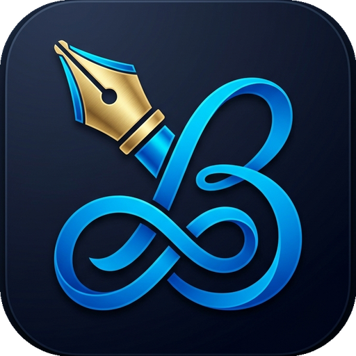

  

# BigNotes

A fast, smooth, infinite canvas note-taking app designed for Android tablets.
---

### Download

**[Download BigNotes v1.1 (APK)](https://github.com/anshumangaurav13/app.goodboy13.bignotes/releases/download/v1.1/BigNotes-v1.1.apk)**

---

## Why BigNotes?

BigNotes gives you the freedom of a physical notebook without boundaries. Whether taking lecture notes, sketching ideas, or solving math problems, everything feels fast and natural.

### Key Highlights

- **Natural, Instant Inking:** Feels just like pen on paper. Optimized for stylus and active pens with near-zero lag and pressure sensitivity.
- **Infinite Canvas:** Never run out of space. Zoom, pan, and keep writing as far as your thoughts take you.
- **Realistic Pens and Brushes:** Switch between a ballpoint pen, pressure-sensitive fountain pen, realistic textured pencil, and highlighters.
- **Handwritten Math Solver:** Write out math equations naturally, and BigNotes calculates the answers directly on the canvas.
- **Easy Editing:** Use the lasso tool to select, move, resize, duplicate, or recolor strokes anytime.
- **Search Your Handwriting:** Find past notes quickly by searching words you handwrote.
- **Simple Organization:** Organize notebooks and pages into clean, custom folders.
- **Export to PDF:** Turn notes into clean, high-resolution multi-page PDF documents ready to share or print.
- **100% Offline and Private:** All notes are saved locally on your device. No account required, no tracking, and no cloud lock-in.

---

## Requirements

- Android 8.0 (Oreo) or newer
- Recommended: Tablet or phone with stylus support (Samsung S Pen, active stylus, or touch)
